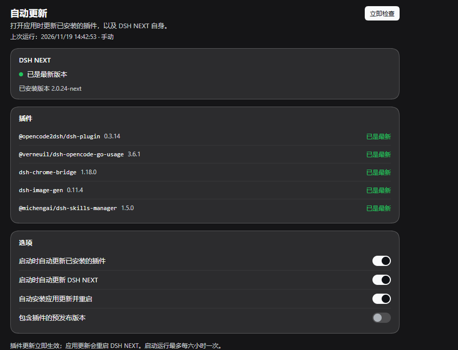
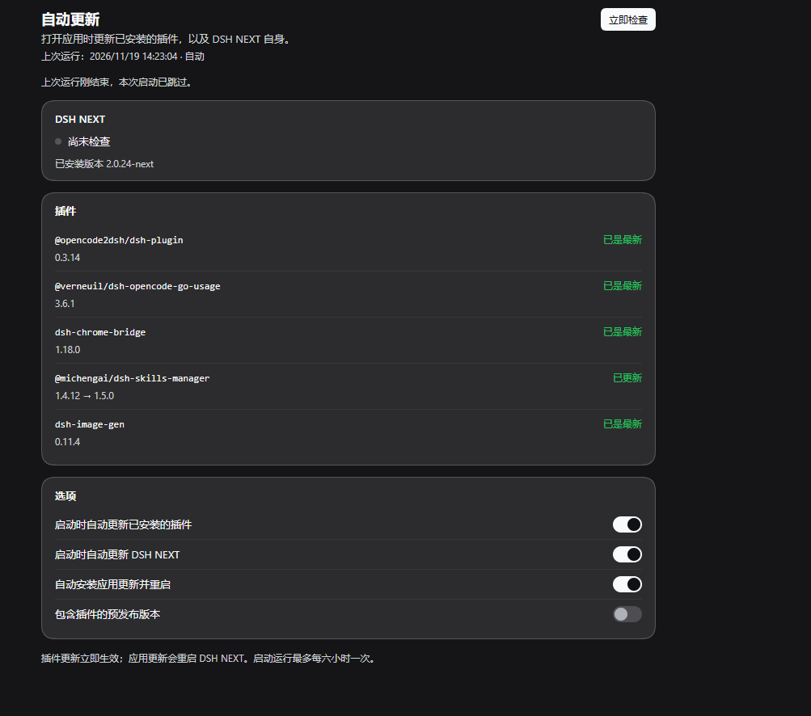

# dsh-next-auto-update

A left-sidebar page for DeepSeek Harness (DSH) that keeps the harness current:
when DSH NEXT opens, it updates every registry-installed plugin, then updates
DSH NEXT itself — check, download the signed installer, install, restart.



| Plugin | Version moved | Status |
| --- | --- | --- |
| `@opencode2dsh/dsh-plugin` | 0.3.14 | up to date |
| `@michengai/dsh-skills-manager` | 1.4.12 → 1.5.0 | updated |
| `dsh-chrome-bridge` | 1.18.0 | up to date |



## What it does on launch

1. **Plugins.** For every bundle the profile installed from a registry it asks the
   registry for newer versions, picks the newest one that still declares a bundle
   patch and accepts the running DSH version, and installs it through the
   `pluginManager` Remote the Plugins page uses — one package at a time, with the
   Host's `checking` / `removing` / `installing` steps shown on the row. A failed
   replace that the Host rolled back reports the version it restored.
2. **DSH NEXT.** Inside the desktop window it drives the shell's own updater
   (`window.desktopNext.command`): `check-updates`, then `download-update`, then —
   when the download is ready — `install-update`, which installs the official
   package and restarts the app. Portable and Linux builds have no in-app
   installer; their row offers the release page instead.

Two further rules guard the app half: a version the app already runs is never
installed again (the shell's comparison can otherwise offer the running release),
and a release whose install did not take effect is not retried automatically — the
panel keeps it visible with **Install again**.

### How the app update is installed

The shell's own install step cannot replace its folder while another process runs
`DSH NEXT.exe` from inside it — Chrome's chrome-bridge native-messaging host does,
and Chrome recreates it within seconds, so a Windows update used to fail with
"system error 5" until Chrome was closed by hand.

The plugin's Host half installs the downloaded package itself: when the shell
finishes downloading a release, `scripts/desktop-install.ps1` starts detached,
temporarily takes the chrome-bridge launcher out of service (so the host cannot
come back), ends the app, runs the official installer silently, restores the
launcher and reopens the app. The browser half only checks and downloads. The
manual **Install and restart** button still uses the shell's own step, so it needs
the install folder free; the automatic path does not.

The panel's **Check now** runs the same pass at any time. The launch pass runs at
most once every six hours; an interrupted pass (a reload during the run) resumes
after 90 seconds. Preferences and the last report live in the window's local
storage, and two DSH windows cannot run a pass at the same time.

## Preferences

- **Update installed plugins on launch**
- **Update DSH NEXT on launch**
- **Install app updates and restart automatically** — off means "check only"; the
  panel then offers a **Download and install** button. The switch controls the
  download, because whatever the shell downloads is what the plugin's Host half
  installs.
- **Include pre-release plugin versions**

## What it does not touch

- Bundles the installation ships itself (for example `dshmarket`): the Host's
  plugin manager marks them non-updatable, and they move with DSH NEXT.
- Packages installed from a local path or a pinned Git commit: they are listed as
  skipped, since no registry version applies.
- It never downloads a package from the internet: the desktop shell fetches the
  release, and only the official installer it produced is run.

## Install

From the Plugins page or the CLI:

```sh
dsh plugin add lijianbin2/dsh-next-auto-update
```

Or **Plugins → Add plugin → local directory** and point it at a checkout of this
repository.

## Availability

The plugin half runs wherever the `pluginManager` Remote is available. The app
half needs the DSH NEXT desktop window, which exposes its updater to the page; in
an ordinary browser the card says so and only plugins are updated.

## 中文

左侧栏「自动更新」页：打开 DSH NEXT 时，先把所有从注册表安装的插件更新到最新兼容版本，
再更新 DSH NEXT 自身——检查、下载官方安装包、安装并重启。插件逐个安装，行内显示
「正在核对版本 / 正在移除旧版本 / 正在安装新版本」；被 Host 回滚的失败会写明回滚到的版本。
「立即检查」可随时手动跑一次；启动运行最多每六小时一次，中断的轮次 90 秒后续跑。

不动的部分：随安装包自带的官方插件（如 `dshmarket`，由 DSH NEXT 带着走）、本地路径或
Git 提交安装的插件（列为已跳过）。应用更新始终走桌面端自带的更新器，本插件不自己下载或
运行安装包。便携版与 Linux 版没有应用内安装器，会改为打开发布页。

## License

MIT
